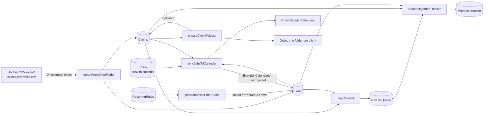

# Jobber to Google Workspace: ops sample for a commercial cleaning company

A small Google Apps Script setup that moves scheduling and client records out of Jobber and into Google Sheets, Google Calendar and Google Drive, built so the office team can keep it running after handover.

## Problem

A commercial cleaning company is leaving Jobber. It already has Jobber exports and a migration spreadsheet. The office needs:

- one client master list and one visit list they can edit,
- recurring cleaning schedules turned into calendar events with location, crew, service window and a link to the client folder, readable on a phone,
- a check of the old records before go-live: outdated clients, duplicates, and a tracker showing how far each data area has moved,
- client folders in Drive with permissions that keep finance records and entry instructions away from crews.

## How it fits together

| Sheet | Columns | Who edits it |
|---|---|---|
| Clients | ClientId, ClientName, Address, ServiceType, Notes, FolderUrl | Office (FolderUrl is filled by the script) |
| Jobs | JobId, ClientId, Date, Start, DurationMin, Crew, Status, Instructions, EventId, CalendarId, LastSynced | Office (last three filled by the script) |
| RecurringRules | RuleId, ClientId, Crew, Weekday, IntervalWeeks, WindowStart, WindowEnd, StartDate, EndDate, Instructions, Active | Office |
| Crew | Crew, CalendarId | Owner, once |
| ReviewQueue | Key, Area, RecordId, Issue, Detail, Found, Resolved | Script adds rows, office ticks Resolved |
| MigrationTracker | Area, Imported, Flagged, Verified, Status, Updated | Script, office types Verified |
| SyncLog | Time, Action, Id, Detail | Script only |

## What the script does

- **Import (upsert).** Reads Jobber CSV exports and matches rows by Jobber id. A second run updates changed rows and never duplicates. A CSV with a missing column stops with a clear message.
- **Recurring schedules.** Each active rule (site, crew, weekday, every N weeks, service window, start and end date) creates visit rows for the next 28 days. The visit id is `RuleId-YYYYMMDD`, so running it again adds nothing, and a visit the office has already changed is left alone. A rule with a broken window is reported, not guessed.
- **Calendar sync.** `Scheduled` and `Confirmed` visits become events on the crew's calendar with client name, address, service window, instructions and the folder link. Event id and calendar id are stored in the row, so:
  - a time change updates the same event,
  - a crew change removes the event from the old crew calendar and creates it on the new one (no duplicate),
  - any other status (`Cancelled`, `Draft`, `On hold`, `Completed`) removes the event.
  Crews see their schedule in the Google Calendar app on their phones by subscribing to their crew calendar.
- **Record check.** `flagRecords` adds to ReviewQueue: clients with no visit in the last 6 months (setting in `Config.gs`), and likely duplicates by normalized name or normalized address (case, punctuation, "LLC", "St/Street" and similar are ignored). Rows are keyed, so Resolved ticks survive the next run.
- **Migration tracker.** `updateMigrationTracker` keeps one row per area (Clients, Visits, RecurringRules, ClientFolders): how many are imported, how many open flags, how many the office has verified, and a status (`Not started`, `Needs review`, `Verifying`, `Done`).
- **Client folders.** Creates `Client Name (ClientId)` under one root folder, reuses an existing folder of that name, and writes the link back.
- **Menu and trigger.** An `Ops` menu runs each step. `installHourlySync` adds an hourly "create visits and sync" trigger.

## Drive permission design (proposal, not set by code)

| Folder | Who gets access | Why |
|---|---|---|
| `Clients/` (root) | Owner, office manager: edit | Full control stays with two people |
| `Clients/<Client>/Site info/` (scope of work, checklist, operating instructions) | Crew assigned to that site: view only | Crews see only the sites they clean, nothing else |
| `Clients/<Client>/Photos and reports/` | Assigned crew: can add; office: edit | Crews can upload proof of work without seeing other files |
| `Clients/<Client>/Access/` (alarm codes, keys, entry instructions) | Owner, office manager, and on request the crew lead for that site: view only | Sensitive entry details are shared one site at a time, never to all crews |
| `Clients/<Client>/Agreements/` (signed contracts) | Owner, office manager | Legal records, not needed in the field |
| `Finance/` (rates, billing, QuickBooks exports) | Owner, bookkeeper | Pricing and billing kept away from crews and site folders |
| `Templates/` (scope, checklist, SOP templates) | Office: edit; crews: view | One source for consistent folders |
| `Migration/` (Jobber exports, tracker, history) | Owner, office manager, freelancer during the project | Historical records kept read only after go-live |

Sharing is done with Google Groups per crew (for example one group per crew), so a cleaner who joins or leaves is changed in one place, not on every folder.

## Setup

1. Create a Google Sheet, open Extensions > Apps Script, and copy the files from `src/` (including `appsscript.json`, shown after enabling it in Project Settings).
2. In Project Settings > Script properties add `CLIENT_ROOT_FOLDER_ID` and `IMPORT_FOLDER_ID`.
3. Fill the `Crew` sheet with each crew name and its Google Calendar id.
4. Put `clients.csv` and `visits.csv` from Jobber in the import folder. The column names the script expects are in `src/Import.gs` (`CLIENT_MAP`, `VISIT_MAP`) and are easy to change to match your export.
5. Add recurring rules (see `sample_data/recurring_rules.csv` for the format).
6. Reload the Sheet and use the Ops menu. Approve permissions on first run.

Local tests: `npm test` (Node 18 or newer, no install needed). 15 tests.

## Suggested first paid milestone

A paid review of your existing records with a clear plan: import the Jobber exports, run the record check, walk through the ReviewQueue together, and fill the MigrationTracker so you can see what is missing before anything goes live. Then a small pilot group of accounts on recurring calendar events, and after that the remaining clients as separate milestones.

## Not in this sample

- Completion reporting form (visit done, issues, supply needs)
- QuickBooks Online and Gusto connections, rate and billing reconciliation
- Setting Drive permissions by code (the table above is a design to apply by hand or in a later step)
- Doc templates for scopes and checklists
- Two-way sync (edits made in Calendar are not written back)
- Direct Jobber API connection (CSV export is used)

## Honest note

All data in `sample_data/` is fictional. The code was checked only locally, with stand-in versions of SpreadsheetApp, CalendarApp, DriveApp and PropertiesService (`test/mocks.js`). It has not been run in a live Google account yet. The Jobber export column names are assumed and must be checked against your own export. I have not used Jobber hands-on; this sample works from its CSV exports.

Background: about 3.5 years building Google Apps Script tools at a company in a Prime-listed group in Japan, including a system used by about 2,700 people.
